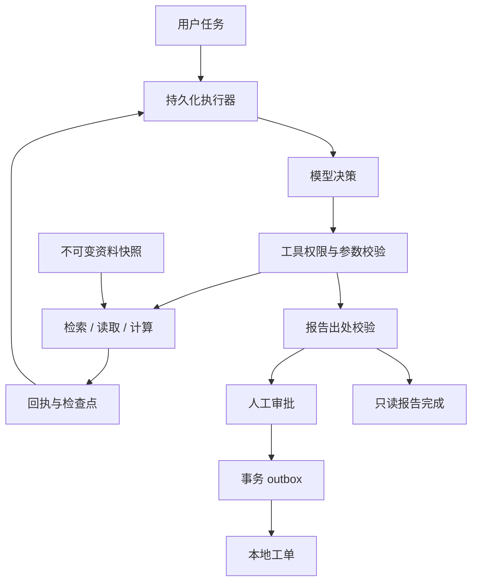

# Evidence Agent Workbench

**一个有证据、有审批、能恢复、可回放的研究决策 Agent。**

把“比较两种嵌入式 Linux 网关方案”这样的任务，转成可观察的规划、检索、读取、计算和报告。模型通过 OpenAI Responses 原生 function calling 自行选择下一步；应用层负责工具权限、引用校验、持久化和副作用审批。

本项目延续 [edge-linux-gateway](https://github.com/3086707459-ai/edge-linux-gateway) 的嵌入式场景，重点展示 Agent 工程能力。可用于内部设备选型、技术资料审阅和验收准备。随附供应商、价格及需求均为**虚构样例**；真实使用时应换成有权处理的资料，并完成下方验收。

## 三分钟运行

Python 3.11+；无需模型密钥即可运行完整工程演示。

```bash
git clone https://github.com/3086707459-ai/evidence-agent-workbench.git
cd evidence-agent-workbench
python3 -m venv .venv
source .venv/bin/activate
python -m pip install -r requirements.lock -e '.[dev]'
evidence-agent serve
```

打开 <http://127.0.0.1:8090>，点击“开始研究”。默认流程会停在人工审批，检查工单正文后点击批准，即可看到本地工单编号。点击“无模型重放”，可以用相同证据重新执行记录的工具决策。

下载源码 ZIP 后，也可直接解压进入项目目录，从创建虚拟环境的命令开始。

> **两种运行模式**：`demo` 是针对随附资料编写的确定性规则，用于无费用演示和工程回归；`openai` 才是模型自主选择工具。已测试真实 SDK 的请求/响应协议，尚未在本交付环境调用真实模型。工程评测通过率不代表模型正确率。

## 可以展示的能力

| 能力 | 实现 | 可验证证据 |
| --- | --- | --- |
| 自主工具选择 | 原生 strict function calling；每轮最多一个调用；先规划再研究 | `providers.py`、SDK MockTransport 协议测试 |
| 有出处的报告 | BM25 + 字符 n-gram 排序融合；先检索后读取；逐条原文引用 | 冻结资料版本、SHA-256、引用与来源数测试 |
| 工具反馈与修复 | 参数/权限/引用失败转成下一轮可见的反馈 | 伪造引用被拒绝后重新提交的测试 |
| 持久化执行 | SQLite WAL/FULL；调用决策先落盘，再执行工具 | SIGKILL 后从 prepared decision 恢复 |
| 并发与取消 | worker lease、epoch fencing、版本条件更新 | 过期 worker 与在途取消结果均不能覆盖新状态 |
| 人工审批 | 审批绑定动作 digest、版本和有效期；可分离审批凭据 | 错误摘要、过期、旧版本、重复审批测试 |
| 可控副作用 | 审批后写 durable outbox；本地工单与 outbox 同事务提交 | 并发重复投递只产生一条本地工单 |
| 可回放与观察 | SSE 游标、结构化回执、事件哈希链、冻结快照回放 | 回放报告一致、零模型调用、无重复副作用 |
| 可交付工程 | FastAPI、中文工作台、CLI、Docker、systemd、CI 配置 | `tests/`、`examples/evaluation-demo.json` |

引用校验验证“这段话确实来自已读取资料”，**不会证明资料正确或语义必然支持结论**。检索是词法检索，无外部 embedding 服务。exactly-once 范围限定在同一个 SQLite 数据库中的本地工单，不扩展到外部系统。

## 工作方式



模型只看当前任务、已读证据、近期工具结果及预算。审批和数据库提交由应用控制，模型没有 shell、任意网络、任意文件读取或批准动作的工具。

## 接入真实模型

在**服务端终端**设置环境变量，再重启服务；不要将密钥写进源码或网页。

```bash
export OPENAI_API_KEY='在本机设置你的密钥'
export OPENAI_MODEL='你账号可用且支持 Responses function calling 的模型 ID'
evidence-agent serve
```

在界面选择 OpenAI 模式。也可使用 CLI：

```bash
evidence-agent run '比较 Atlas 和 Boreal 的离线部署、审计和三年成本，并引用资料' --provider openai --ticket
```

`.env.example` 只说明变量，Python 服务不会自动加载 `.env`。SDK 使用 `store=False`，但模型仍会收到任务和选中的资料；这不等同于服务商零保留承诺。运行前请确认数据处理权限。调用超时、重试和计费边界见 [部署文档](docs/DEPLOYMENT.md)。

## 测试与评测

```bash
ruff check src tests scripts
ruff format --check src tests scripts
pytest --cov=evidence_agent --cov-report=term-missing --cov-report=xml:out/coverage.xml
evidence-agent evaluate --output out/evaluation.json
```

随附工程评测覆盖引用出处、多来源、审批阻断、摘要绑定、Decimal 计算、重复投递、回放一致性、事件完整性和证据不足弃答。评测包含 8 项检查，其中引用出处与多来源为一项。

真实模型结构检查需要显式选择，会消耗 API 额度：

```bash
evidence-agent evaluate --provider openai --output out/evaluation-live.json
```

这仍然不是语义质量评测。多模型、多任务、人工标注的评测协议见 [EVALUATION.md](docs/EVALUATION.md)。实际交付验证记录见 [VALIDATION.md](docs/VALIDATION.md)。

## 文件入口

| 路径 | 内容 |
| --- | --- |
| `src/evidence_agent/engine.py` | Agent 循环、预算、恢复与工具执行 |
| `src/evidence_agent/store.py` | 状态机、租约、审批、outbox 和审计 |
| `src/evidence_agent/providers.py` | OpenAI、确定性 demo、回放 provider |
| `src/evidence_agent/tools.py` | 词法检索、受限计算、引用校验 |
| `src/evidence_agent/api.py` | HTTP API、鉴权、SSE 和任务调度 |
| `src/evidence_agent/static/` | 无前端构建依赖的中文工作台 |
| `corpus/` | 可信管理员导入的虚构样例及注入测试文本 |
| `tests/` | 协议、并发、恢复、API、CLI 与回归测试 |
| `docs/` | 架构、接口、部署、评测与面试讲解 |

## 进一步使用

- [架构与关键不变量](docs/ARCHITECTURE.md)
- [API 与审批示例](docs/API.md)
- [部署、备份与故障处理](docs/DEPLOYMENT.md)
- [评测范围与真实模型验收](docs/EVALUATION.md)
- [安全边界](SECURITY.md)
- [求职展示与面试问题](docs/INTERVIEW.md)

当前适合本机或受控团队试用：单进程两个 worker、最多 16 个活跃任务、最多 100 份 Markdown 资料。尚未实现多租户身份、分布式队列、外部工单连接、自动资料更新或运维级数据保留策略。请按实际场景补齐后再承担生产业务。

MIT License。
