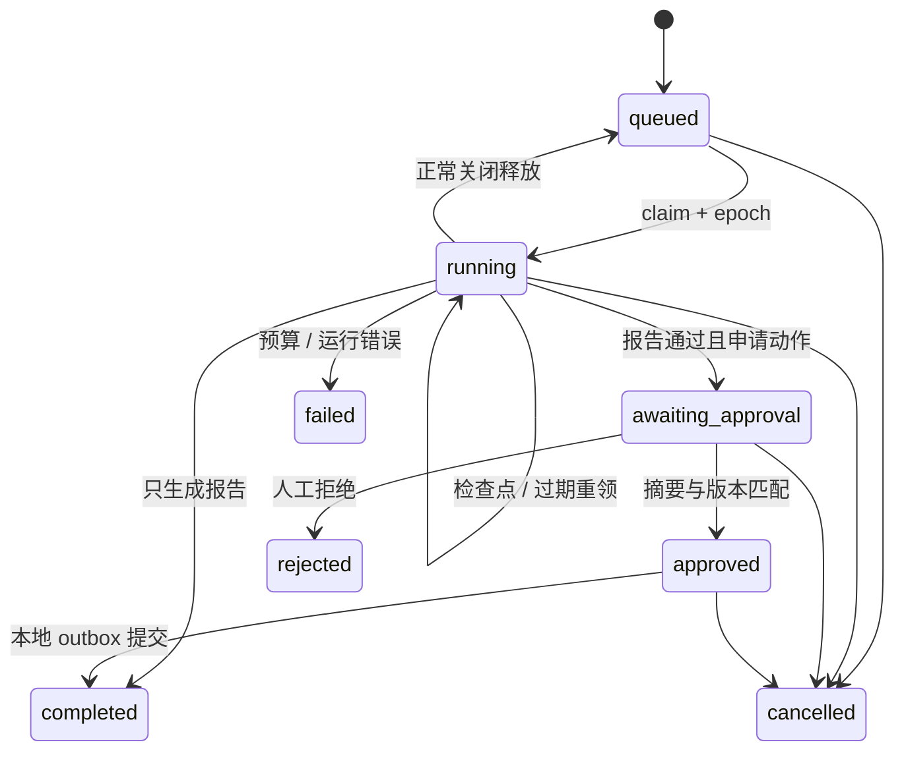

# 架构与关键不变量

## 决策与执行分开

一次运行的 durable state 包含计划、检索 ID、已读证据、计算回执、工具回执、待执行决策、报告、审批、预算用量和错误码。数据库保存全量回执；提供给模型的上下文只取近期结果和受限证据，最大 24 KB。

模型决定下一步工具和参数。每轮只接收一个已完成的 function call；`parallel_tool_calls=False`，空计划时强制调用 `propose_plan`。应用按白名单验证参数和当前状态，拒绝后把反馈写入回执，下一轮可据此修复。它是单 Agent 的反馈循环，不需要为每个步骤包装不同的角色。

| 工具 | 允许的效果 | 应用约束 |
| --- | --- | --- |
| `propose_plan` | 修改当前计划 | 2–6 个步骤；研究前必须有计划 |
| `search_evidence` | 从当前冻结快照检索 | 每次最多 5 个命中；累计最多保留 50 个 ID |
| `read_evidence` | 读取已检索片段 | 只读当前快照；最多 6 个证据片段 |
| `calculate` | Decimal 四则运算 | AST 白名单；120 字符、32 节点、结果绝对值 ≤ 10¹² |
| `submit_report` | 提交结构化报告 | 引用已读片段、原文精确匹配、哈希和来源数检查 |

`min_sources` 默认 2。这里“不同来源”指不同 document ID，不证明出版主体相互独立。`insufficient_evidence` 报告必须为空 claims，防止一边弃答一边输出未经验证的断言。推荐语和限制项仍需人工审阅。

## 检索与资料版本

管理员提供目录，启动时导入最多 100 份 `.md` 文件，单文件最多 50 KB，拒绝符号链接。系统按段落切片，每片最多 1,200 字符；文件名与完整内容共同计算 document ID。旧版本保留，新运行固定创建时的 document ID 集合。

检索融合两种真实计算的排名：BM25（英文词及中文双字切分）和字符三元组 Jaccard 相似度，以 RRF 常数 60 合并。没有向量模型和外部检索网络依赖。适合小型受控文档集；应通过真实任务标注 Recall@k 后，再决定是否引入 embedding 或 reranker。

保存的 chunk 带文本 SHA-256。报告只允许引用本次已读取的 chunk，引用必须是原文子串，并验证保存文本的哈希。跨版本回放继续使用原始快照，不会悄悄改用更新后的报价。

## 运行状态机

报告证据不足时即使申请了工单，也直接完成，不生成待批动作。审批过期后拒绝执行，用户可以取消并重新创建研究任务。

## 崩溃一致性与租约

每轮顺序：

1. 检查步骤、已观测 token 和墙上时间预算。
2. 模型返回决策后，把决策、用量和 `decision.prepared` 事件原子写入。
3. 执行纯工具，在内存更新状态。
4. 把结果、回执、状态转换和 `tool.completed` 事件原子写入，清空 pending。

在步骤 2 之后被 SIGKILL：重启后等待租约过期（默认 90 秒），新 worker 直接执行保存的 pending 决策。只读工具和计算允许重执行，执行结果与回执仍一次提交。模型调用已发出但尚未保存决策时崩溃，可能再次调用并再次计费，这个窗口不能靠本地数据库消除。

`BEGIN IMMEDIATE` 串行化写事务；每次领取增加 epoch。checkpoint 要求 owner、epoch、running 状态和租约有效期同时匹配。租约以默认 30 秒间隔续期；旧 worker、已取消运行和丢失租约的结果不能提交。正常关闭会取消在途协程并释放为 queued；这个状态变化也增加版本并记录事件。

这是单进程、单 SQLite 文件设计，不宣称分布式一致性。SQLite 同步操作会短暂阻塞事件循环；资料和状态上限使当前演示可控。扩展前应测量事务尾延迟，再考虑独立持久化服务。

## 审批与副作用

动作 payload 包含工单正文、标题、run ID、动作类型、稳定 action key 和快照摘要。审批提交要求以下三者匹配：

- 当前 run version，拒绝用户审阅期间发生的状态变化；
- payload digest，确保批准的正文就是将执行的正文；
- 未到期的审批（默认 1 小时），避免长期悬置批准。

批准与 outbox 插入同一事务。投递器在**同一 SQLite 事务**内检查摘要、插入带唯一 action key 的 ticket、标记 outbox 已完成，并结束运行。并发重复投递受数据库唯一约束保护。

如果将来接 Jira 等远端系统，应保留稳定 idempotency key、实现远端查重/对账和不确定状态恢复。远端请求超时可能已产生副作用，不能简单宣称外部 exactly-once。

## 幂等、观察与回放

创建任务和审批都要求 `Idempotency-Key`。相同 key 与相同请求返回当前运行；相同 key 与不同内容冲突。取消通过版本控制；重复取消会冲突，调用方重新获取状态即可判断是否已取消。

SSE 的 `id` 是数据库全局递增 seq，但按 run 过滤。使用 `?after=<seq>` 恢复，只返回该游标之后的事件。每条连接最多 300 秒，前端重连并延续游标。日志记录可见操作与摘要，不保存私有思维链。

事件包含 previous_hash 和自身 hash，能发现未重新计算整条链的篡改。控制数据库的人能够重写整条链；要得到独立可信审计，需要外部签名、外部锚点或不可变存储。

回放创建新 run，重用原始资料快照和已完成工具决策；provider 从回执读取决策，调用用量记为 0，并强制关闭工单动作。它验证工具与报告计算的一致性，不重现模型推理，也不把历史 decision 中可能已出错的判断改成正确判断。跨代码版本应固定源码提交再比较结果。
